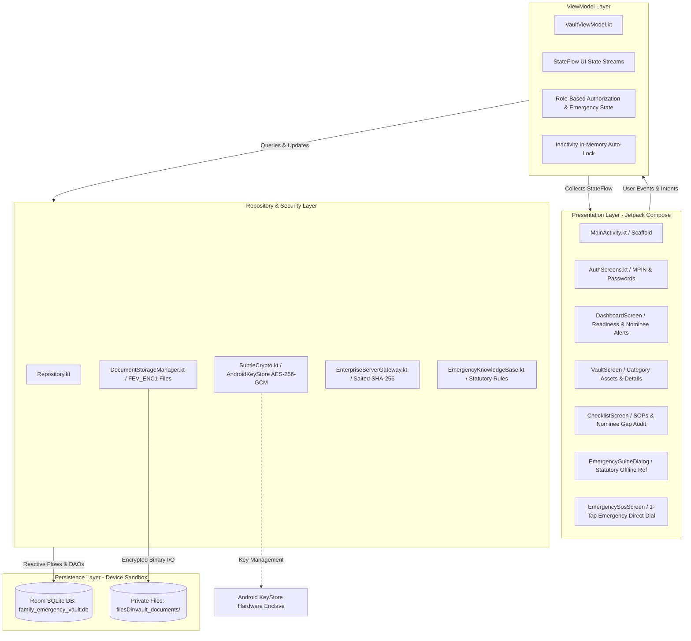
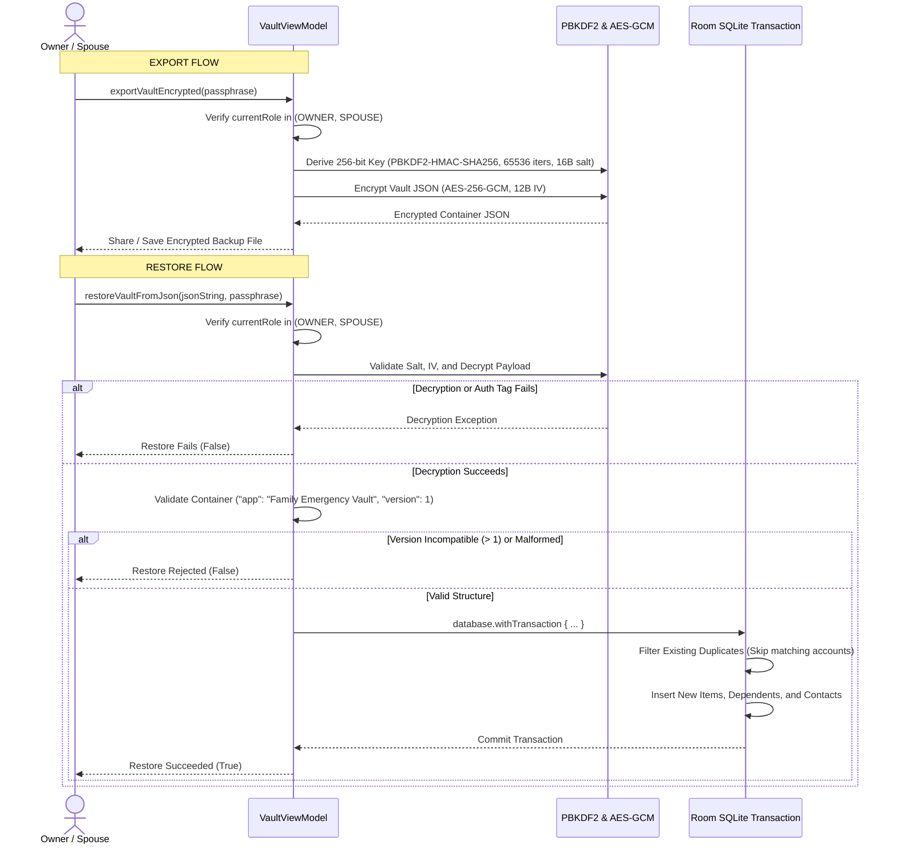
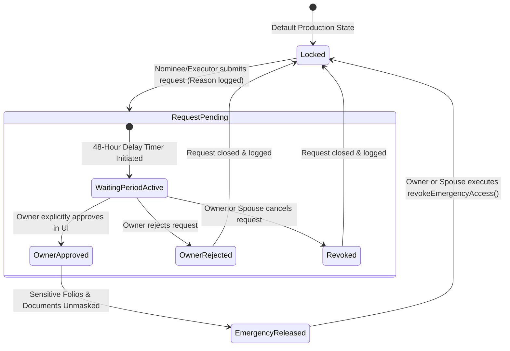

# Family Emergency Vault — System Architecture Specification (`architecture.md`)

> **Document Status**: Complete Implementation Audit (Phases 1–4 & Release Gate Remediation)  
> **Last Verification**: October 21, 2026  
> **Authority**: Actual repository source code (`app/src/main/`) and automated test suite (`ExampleRobolectricTest.kt`).

---

## 1. High-Level Architectural Pattern

Family Emergency Vault implements **Clean Architecture** and **Android MVVM (Model-View-ViewModel)** with an **offline-first, zero-knowledge privacy** model. There are no remote backends, external database servers, or cloud synchronization services. All data resides in private Android application storage.



---

## 2. Layer-by-Layer Responsibilities

### A. Presentation Layer (`app/src/main/java/com/example/MainActivity.kt`)
- **Single Activity Architecture**: `MainActivity.kt` acts as the single host activity using Jetpack Compose and `androidx.activity.compose.setContent`.
- **Navigation & Routing**: Bottom `NavigationBar` for compact mobile screens (<600dp); automatically transitions to `NavigationRail` for wide/tablet displays (>600dp).
  - 5 Primary Destinations: `Dashboard`, `Vault`, `Plan`, `SOS`, and `Settings`.
- **Responsive Dialogs**: All modals (`AddEditVaultItemDialog`, `VaultDetailDialog`, `AddEditDependentDialog`, `AddEditContactDialog`) enforce `heightIn(max = 680.dp)` and `verticalScroll` to ensure compatibility across screen sizes (320px to 1440px).
- **Accessibility & Touch Targets**: Interactive controls maintain minimum 48dp x 48dp touch targets with descriptive content descriptions.

### B. ViewModel Layer (`app/src/main/java/com/example/ui/VaultViewModel.kt`)
- **State Management**: Holds and exposes immutable `StateFlow` streams for UI consumption (`vaultItems`, `familyDependents`, `importantContacts`, `emergencyActionItems`, `auditLogs`).
- **Role-Based Access Control (RBAC)**:
  - Tracks `currentRole` (`OWNER`, `SPOUSE`, `DEPENDENT`, `EXECUTOR`, `ADVISOR`).
  - Controls identifier masking: Sensitive account/policy identifiers (`numberOrId`) are transformed to `••••••••` for `EXECUTOR`, `DEPENDENT`, and `ADVISOR` unless emergency release is active.
- **Emergency Access State**: Manages `isEmergencyAccessReleased`, `isWaitingPeriodActive`, and emergency access approval timers.
- **Readiness Scoring**: Computes actual household readiness (0–100%) grounded entirely in verified records (assets, contacts, insurance, documents) with zero fabricated baseline metrics.
- **Backup & Restore Orchestration**: Executes encrypted PBKDF2 export and transactional restore.

### C. Repository Layer (`app/src/main/java/com/example/data/Repository.kt`)
- Acts as the single abstraction boundary mediating between the ViewModel and Room DAOs.
- Runs database operations on `Dispatchers.IO`.
- Dispatches audit logs via `logAction(action, details, role)`.
- Exposes maintenance tasks: `checkIntegrity()`, `pruneAuditLogs()`, `runVacuum()`, and `runWalCheckpoint()`.

### D. Persistence Layer (`AppDatabase.kt`, `Dao.kt`, `Entities.kt`)
- **SQLite Database**: `family_emergency_vault.db`, compiled with KSP via Room 2.6.1.
- **Entities & Tables**:
  1. `VaultItem` (`vault_items`): Financial and physical asset folios, nominee details, and attachment URI references.
  2. `FamilyDependent` (`family_dependents`): Household dependents, blood groups, guardianship details, and emergency notes.
  3. `ImportantContact` (`important_contacts`): Emergency contacts, medical doctors, legal advisors, and priority flags.
  4. `EmergencyActionItem` (`emergency_action_items`): Succession checklists categorized into 24-Hour, 7-Day, and 30-Day phases.
  5. `ClaimRecord` (`claim_records`): Insurance and asset transmission claim tracking records.
  6. `EmergencyAccessRequest` (`emergency_access_requests`): Emergency access request submissions, timestamps, and status.
  7. `AuditLog` (`audit_logs`): Immutable local security event audit trail.
  8. `ServerUserRecord` (`server_user_records`): Local account authentication records.

---

## 3. Cryptography & Key Management Specification

### A. Android KeyStore AES-256-GCM (`SubtleCrypto.kt`)
- **Key Storage**: Android KeyStore enclave (`AndroidKeyStore`) under alias `fev_vault_hardware_key`.
- **Algorithm**: `AES/GCM/NoPadding` (256-bit key size).
- **Parameters**: 128-bit authentication tag, 12-byte random Initialization Vector (IV) generated per operation via `SecureRandom`.
- **Hardware vs. Software Backing**:
  - Targets the device's hardware-backed Trusted Execution Environment (TEE).
  - Dedicated StrongBox (`setIsStrongBoxBacked(true)`) is **not requested** in the builder to prevent fatal `StrongBoxUnavailableException` crashes on the wide majority of Android devices lacking a discrete security chip.
  - In JVM test environments where `AndroidKeyStore` SPI is unavailable, `SubtleCrypto` falls back dynamically to an ephemeral `SecureRandom` 256-bit in-memory key (no hardcoded keys).

### B. Authenticated Document File Format (`FEV_ENC1`)
All private document attachments saved via `DocumentStorageManager.kt` use a custom authenticated binary envelope:

```
+-----------------------------------------------------------------------------------------+
|                                FEV_ENC1 ENCRYPTED FILE FORMAT                           |
+--------------------+---------------------+-----------------------------+----------------+
|  Magic Identifier  |  Initialization IV  |      AES-256-GCM Payload     |  GCM Auth Tag  |
|      (8 Bytes)     |      (12 Bytes)     |       (Variable Size)       |   (16 Bytes)   |
|     "FEV_ENC1"     |    SecureRandom     |          Encrypted          | Authenticated  |
| 0x4645565F454E4331 |     Random IV       |         File Bytes          | Integrity Tag  |
+--------------------+---------------------+-----------------------------+----------------+
```

1. **Ingestion & Size Limits**:
   - Accepts input streams from Photo Picker or Camera bitmaps.
   - Strictly enforces a maximum file size of 10 MB. Allowed extensions: `jpg`, `jpeg`, `png`, `webp`, `pdf`.
2. **Safe Atomic File Writes**:
   - Writes encrypted bytes to a temporary staging file (`safeName.tmp`).
   - Flushes stream and executes `fos.fd.sync()` to force physical disk synchronization.
   - Atomically renames `safeName.tmp` to `targetFile`.
   - Interrupted writes or crashes leave existing files completely untouched.
3. **Decryption & Tamper Protection**:
   - Inspects the first 8 bytes for `FEV_ENC1`.
   - Passes IV and ciphertext with tag to `SubtleCrypto.decryptBytes()`.
   - Any ciphertext tampering or bit flips cause GCM tag verification to throw, which is caught to return `null` safely.
4. **Non-Destructive Legacy Migration**:
   - `migrateLegacyDocumentsToEncrypted()` scans `vault_documents/`.
   - If an unencrypted legacy file is found, it is read and encrypted to `.tmp` first.
   - The original file is **never deleted or overwritten** until the encrypted replacement is verified and renamed.
5. **Legacy Base64 Field**:
   - `VaultItem.documentPhotoBase64` is retained solely for **backward-compatibility** with early Phase 1 database rows. All active production code sets `documentPhotoBase64 = ""` and stores files via `attachmentUri`.

---

## 4. Backup & Restore Architecture



### PBKDF2 Parameters
- **KDF**: `PBKDF2WithHmacSHA256`
- **Iterations**: 65,536 iterations (standard NIST recommendation for mobile key derivation)
- **Salt**: 16-byte random salt generated via `SecureRandom`
- **Encryption**: AES-256-GCM (128-bit authentication tag, 12-byte IV)
- **Transactional Rollback**: Any schema error, malformed JSON, or database failure during restore triggers an automatic rollback of the Room database transaction, leaving existing records completely intact.

---

## 5. Emergency Access & Succession Workflow



### Authorization Rules Enforced in Code
1. **Approval Authority**: `approveRequest()` requires `currentRole == UserRole.OWNER`. Submissions by `EXECUTOR`, `DEPENDENT`, or `ADVISOR` are rejected and audited.
2. **Revocation Authority**: `revokeEmergencyAccess()` requires `currentRole in (OWNER, SPOUSE)`.
3. **Data Masking during Pending/Locked State**:
   - `numberOrId` is masked with `••••••••`.
   - Document attachment previews are gated behind `canViewDocument` (`OWNER`, `SPOUSE`, or `isEmergencyAccessReleased == true`).

---

## 6. Local Authentication Specification & Security Analysis

### Current Implementation (`EnterpriseServerGateway.kt`)
- **Password Hashing**: Single-round SHA-256 with a 16-byte random salt derived via `SecureRandom`.
  ```kotlin
  fun hashPassword(password: String, salt: String): String {
      val digest = MessageDigest.getInstance("SHA-256")
      digest.update(salt.toByteArray(StandardCharsets.UTF_8))
      return digest.digest(password.toByteArray(StandardCharsets.UTF_8))
          .joinToString("") { "%02x".format(it) }
  }
  ```
- **Session Tokens**: Local on-device JWTs signed with an ephemeral in-memory 256-bit HMAC-SHA256 secret key (`jwtSecretBytes`).

### Security Analysis & Risk Disclosure
- **Risk**: Single-round SHA-256 lacks memory-hardness or computational work factor. While protected by Android's internal sandbox on non-rooted devices, if an attacker gains root access or extracts `family_emergency_vault.db`, single-round SHA-256 can be brute-forced rapidly on modern hardware.
- **Migration Plan**:
  1. Add an algorithm prefix to password hashes: `$pbkdf2$600000$salt$hash`.
  2. During authentication, if the stored hash lacks the prefix, evaluate via the existing `hashPassword(password, salt)` function.
  3. On successful authentication, automatically upgrade the stored record by re-hashing with `PBKDF2WithHmacSHA256` (600,000 iterations per OWASP recommendations) and saving to `ServerUserRecord`.
  4. Ensure new registrations use the upgraded scheme by default.

---

## 7. Web Companion Architecture & Demo Boundary

```
+-----------------------------------------------------------------------------+
|                          WEB COMPANION SANDBOX                              |
|                          (public/index.html)                                |
+-----------------------------------------------------------------------------+
|  Platform: Standalone HTML5 / Alpine.js / Tailwind CSS                      |
|  Execution: 100% Client-Side inside the user's browser                      |
|  Storage: Unencrypted browser localStorage (fev_vault_items, etc.)          |
|  Real Data Entry: DISABLED (Safety alert modal prevents entry)              |
|  Encryption: None (Does NOT possess AndroidKeyStore hardware keys)          |
|  Sync: Zero (Does NOT communicate with native Android app or any backend)   |
|  Purpose: Interactive Demonstration & Succession SOP Planning Guide Only   |
+-----------------------------------------------------------------------------+
```

### Safety Controls
- **Data Entry Policy**: Real data entry is disabled in JavaScript (`openAddModal`, `saveAsset`, `openAddDependentModal`). Attempting to add records triggers an explicit warning modal directing the user to the native Android app.
- **Zero Network Outbound**: No `fetch()` or `XMLHttpRequest` calls exist in `public/index.html`.

---

## 8. Android Backup Exclusions & System Rules

In `app/src/main/res/xml/data_extraction_rules.xml` and `backup_rules.xml`, sensitive vault records are explicitly excluded from automatic cloud backups:

```xml
<data-extraction-rules>
    <cloud-backup>
        <exclude domain="database" path="family_emergency_vault.db" />
        <exclude domain="database" path="family_emergency_vault.db-wal" />
        <exclude domain="database" path="family_emergency_vault.db-shm" />
        <exclude domain="file" path="vault_documents" />
    </cloud-backup>
    <device-transfer>
        <exclude domain="database" path="family_emergency_vault.db" />
        <exclude domain="file" path="vault_documents" />
    </device-transfer>
</data-extraction-rules>
```

**Rationale**: Android Auto Backup to Google Drive does not transfer hardware `AndroidKeyStore` private keys. Backing up the database or encrypted attachments to cloud storage would lead to unrecoverable data on new devices, and would breach the zero-cloud-leakage guarantee.

---

## 9. Verification Summary & Test Evidence

| Verification Scope | Method | Evidence / File | Result |
| :--- | :--- | :--- | :---: |
| Authenticated Document Encryption & Tampering | Robolectric JVM | `ExampleRobolectricTest.kt:817` | **PASS** |
| Encrypted Backup, Rejection & Transaction Rollback | Robolectric JVM | `ExampleRobolectricTest.kt:865` | **PASS** |
| Emergency Access RBAC Approval & Revocation | Robolectric JVM | `ExampleRobolectricTest.kt:925` | **PASS** |
| Nominee Gap Audit Across 6 Asset Categories | Robolectric JVM | `ExampleRobolectricTest.kt:692` | **PASS** |
| Zero-Data Onboarding & Isolated Demo Mode | Robolectric JVM | `ExampleRobolectricTest.kt:53` | **PASS** |
| Total Automated Unit/Robolectric Tests | Gradle 9.3.1 | `gradle :app:testDebugUnitTest` | **29 / 29 PASS** |
| Release Build Dry-Run Configuration | Gradle 9.3.1 | `gradle :app:assembleRelease --dry-run` | **PASS** |

### Unverified on Cloud Environment (Requires Physical Device Testing)
- `BiometricPrompt` hardware sensor verification: **NOT VERIFIED** (requires physical fingerprint/face sensor).
- Android KeyStore TEE persistence across physical factory reset: **NOT VERIFIED** (requires physical OEM hardware).
